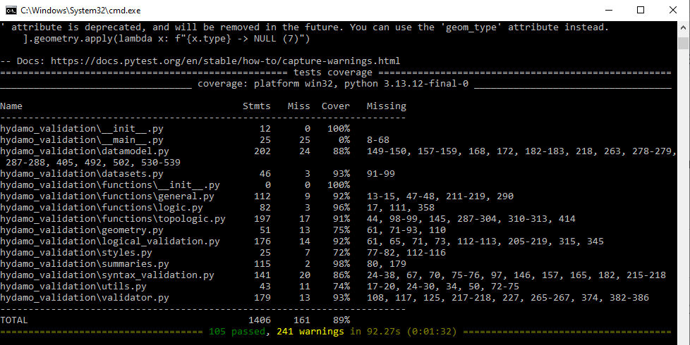

# Release

Deze handleiding volgt op de handleiding `contribute` en beschrijft de release-procedure vanuit de main branch.

## 1. Verander het versienummer van de module

Kies het nieuwe versienummer volgens _semantic versioning_:

- **MAJOR**: brekende wijzigingen (bijv. `1.0.0` → `2.0.0`)
- **MINOR**: nieuwe functionaliteit, achterwaarts compatibel (bijv. `1.3.0` → `1.4.0`)
- **PATCH**: bugfixes, kleine wijzigingen (bijv. `1.3.2` → `1.3.3`)

Voorbeeld: huidige versie is `1.4.1`, je kiest `1.4.2` omdat we bestaande functionaliteit hebben verbeterd.

Zet het versienummer in `hydamo_validation/__init__.py` achter [`__version__`](https://github.com/HetWaterschapshuis/HyDAMOValidatieModule/blob/main/hydamo_validation/__init__.py#L4).

Zorg dat alle wijzigingen via Pull Requests zijn gecommit in de main branch


## 2. Testen
Test de release met de runtimeversies uit het gecommitteerde `requirements.lock`.
Gebruik Python 3.12 en installeer pytest met de constraints uit de bestaande
lockbestanden, zodat de runtimeversies tijdens het testen behouden blijven:

```sh
uv venv --python 3.12
uv pip sync requirements.lock
uv pip install --constraint requirements.lock --constraint requirements-dev.lock pytest
uv pip install --no-deps .
uv pip check
uv run --no-sync python -m pytest
```

`requirements.lock` blijft in de repository en wordt bij het publiceren niet
opnieuw gegenereerd. Als dependencies moeten wijzigen, werk dan het lockbestand
vooraf bij in de PR en test opnieuw. Gebruik bij het compileren `--universal`
voor de ondersteunde platforms en Python 3.12; controleer vervolgens de
installatie op die platforms.

Publiceer alleen als alle tests slagen:


## 3. Aanmaken van een release
Zorg dat alle wijzigingen via Pull Requests zijn gecommit in de main branch

1. Ga naar de GitHub-pagina van de repository.
2. Klik op Releases (rechts in de sidebar of onder het tabje “Code”).
3. Klik op `Draft a new release` (of New release).
4. Kies `Tag: Select tag` en kies `Create new tag`. Maak een annotated tag gelijk aan versienummer, dus `v.X.Y.Z`, bijvoorbeeld `v1.4.2`
5. Laat `Target: main`
6. Zet de tag in de `Release title`, dus weer `vX.Y.Z`, dus `v1.4.2` in het voorbeeld hierboven
7. `Release notes`, klik eventueel `Generate release notes` en/of beschrijf de belangrijkste wijzigingen:
    * Nieuwe features
    * Bugfixes
    * Breaking changes
8. Klik op `Publish release`

Je ziet nu een nieuwe release beschikbaar in GitHub met een `afdruk` van de code uit de main branch

De workflow **Test release and publish lockfile** (`.github/workflows/release.yml`)
checkt expliciet de releasetag uit en installeert de runtime-dependencies uit het
`requirements.lock` van die tag. De workflow controleert de packageversie tegen
de tag en voert de CLI- en regeltests uit op Windows x64, Linux x64 en macOS
ARM64 met Python 3.12. Deze tests draaien ook op PRs naar `main`.
De volledige testsuite blijft onderdeel van de handmatige releasecontrole hierboven.

Pas nadat de drie platformcontroles slagen, uploadt de workflow het ongewijzigde
`requirements.lock` van de tag als release asset. Controleer de workflow en het
asset bij de release. Bij een fout ontbreekt het asset; herstel de oorzaak en
voer de mislukte workflow opnieuw uit. Het lockbestand uit de actuele `main`
wordt hiervoor niet gebruikt. De bestaande workflow publiceert alleen
documentatie; daarom is hiervoor een afzonderlijke releaseworkflow toegevoegd.

Gebruikers kunnen daarna de [reproduceerbare installatie](get_started.md#install-a-release-reproducibly)
volgen. De gepinde geospatial dependencies beperken de platformversies; macOS
ARM64 vereist bijvoorbeeld macOS 14 of nieuwer voor de huidige pyproj-wheel.

## 4. Publiceren op PyPi

Gebruik hiervoor een schone checkout van dezelfde releasetag, zodat de code op
PyPI overeenkomt met de geteste release en het gepubliceerde lockbestand.

Publiceren doe je door de volgende stappen:
1. Activeer het Pyhton-enviroment en verplaats de commandline naar de lokale repository
2. Leeg de distributies-map: rmdir /s /q dist
3. Bouw lokaal de distributies met `python setup.py sdist` 
4. Upload naar PyPI `twine upload dist/* -p jouw_eigen_twine_password`

De laatste release moet nu ook beschikbaar zijn op https://pypi.org/project/hydamo-validation/ en wordt vanaf nu geinstalleerd met `pip install hydamo-validation`
